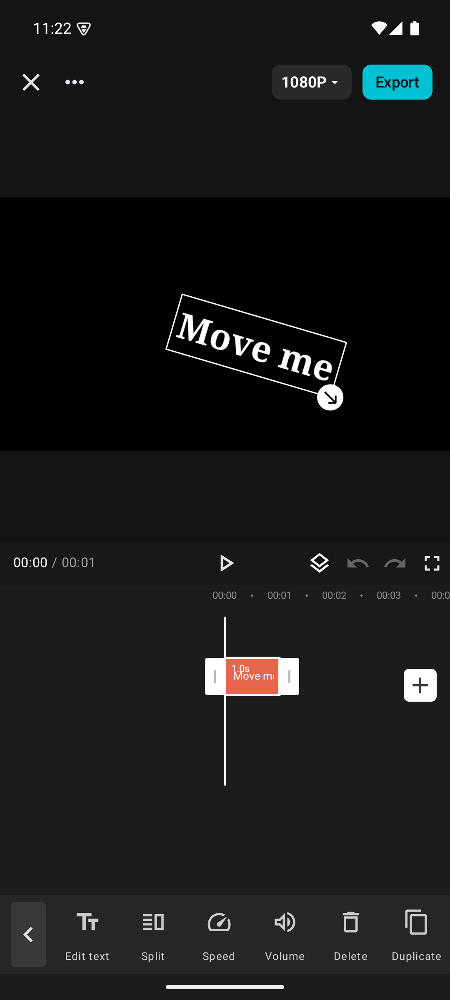
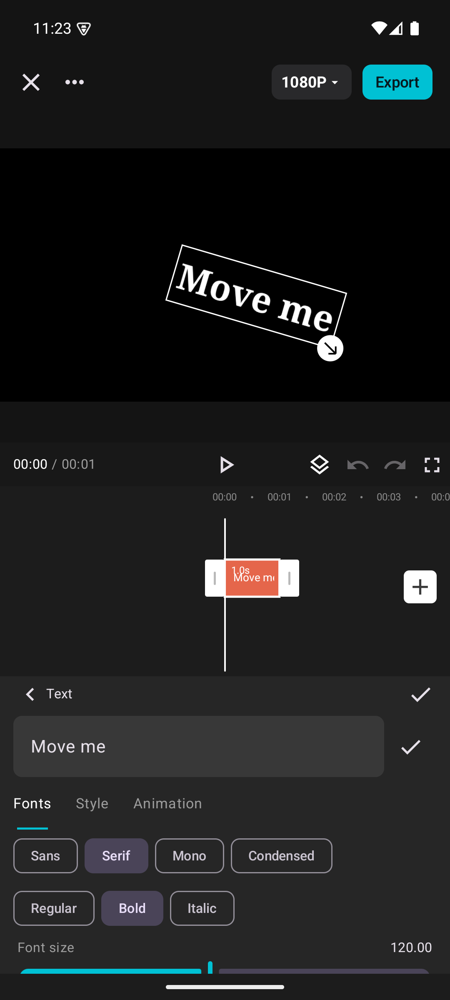
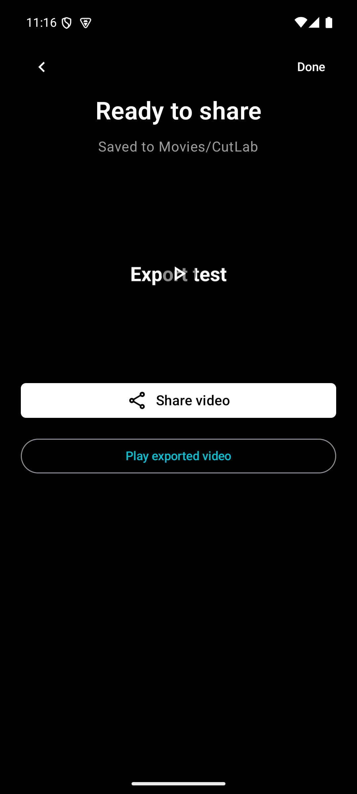

<div align="center">

# CutLab

**An open-source video editor for Android. Edit locally. Keep your projects.**

[](https://github.com/dharmendrathinks/cutlab/actions/workflows/ci.yml)
[](LICENSE)
[](docs/DEVELOPMENT.md)
[](docs/ARCHITECTURE.md)

[Get started](#get-started) · [User guide](docs/USER_GUIDE.md) · [Contribute](CONTRIBUTING.md) · [Roadmap](docs/ROADMAP.md)

</div>

CutLab combines a multitrack timeline, direct preview manipulation, local effects, and H.264/AAC export in a native Kotlin and Jetpack Compose app. Your media and project files stay on your device. No account, ads, analytics, or Internet permission.

**Early-stage software (0.4.0).** The editing workflow has emulator coverage; physical-device codecs, performance, and microphone quality still need testing. Keep backups of projects you care about. See [validation and limitations](docs/TESTING.md).

<p align="center">
  
  
  
</p>

<p align="center"><sub>Actual emulator captures with synthetic media. Editor/text captures are from 0.3; export is from 0.4. <a href="docs/assets/README.md">Screenshot provenance</a>.</sub></p>

## What you can do

| Area | Tools |
| --- | --- |
| Timeline | Trim, split, reorder, duplicate, ripple, snap, frame stepping, zoom, undo/redo |
| Composition | Video and image overlays, crop, position, scale, rotation, opacity, transform keyframes |
| Text | Multiline text, four system font families, outline, shadow, background, entrance/exit animations |
| Look | Color adjustments, eight filter presets, five effects, five masks, chroma key, ten transitions |
| Timing and audio | Speed curves, reverse, freeze insertion, audio import/extraction, volume, fades, recording |
| Export | SDR H.264/AAC MP4, 720p/1080p, 24–60 fps when supported, cancel/retry, Android sharing |
| Projects | Local autosave, previous-checkpoint recovery, covers, portable `.cutlab.zip` archives |

Export resolution is the short edge of the canvas; codec support depends on the device. Speed changes also change audio pitch. There are no AI/cloud features, downloaded catalogs, HDR/4K exports, or third-party project importers.

## Get started

The supported starting point is a source build. There is no production-signed release yet. Successful [CI runs](https://github.com/dharmendrathinks/cutlab/actions/workflows/ci.yml) also retain a development APK temporarily; downloading Actions artifacts requires a GitHub login.

Install **JDK 21**, **Android SDK Platform 36**, **Build Tools 35.0.0**, and platform-tools. Set `JAVA_HOME` and `ANDROID_HOME`, or set `sdk.dir` in an untracked `local.properties`. Android Studio can install these SDK components.

```sh
git clone https://github.com/dharmendrathinks/cutlab.git
cd cutlab
./scripts/gradle.sh :app:assembleDebug
adb install -r app/build/outputs/apk/debug/app-debug.apk
```

On Windows, use `gradlew.bat :app:assembleDebug` with JDK 21 configured. The first build downloads Gradle and Maven dependencies. Open the repository root in Android Studio to work on the app.

Launch **CutLab → Try demo** to explore without importing media, or **New project** to select videos/images. Select a clip to reveal its tools. Tap **Export** to save to `Movies/CutLab`. Follow the [user guide](docs/USER_GUIDE.md) for gestures, backups, and supported formats.

Debug builds use the builder's local debug key. APKs from different machines may not update each other; export your project archives before uninstalling. Release builds are unsigned by default. See [release instructions](docs/RELEASING.md).

## Development

```sh
./scripts/check.sh          # Repository checks, JVM tests, APK build, Android lint
./scripts/device-check.sh   # Full instrumentation suite; one connected device/emulator
```

| Resource | Contents |
| --- | --- |
| [Development](docs/DEVELOPMENT.md) | Toolchain, module map, local workflow, troubleshooting |
| [Architecture](docs/ARCHITECTURE.md) | Timeline math, shared rendering, audio, storage |
| [Testing](docs/TESTING.md) | Test layers, fixture provenance, reproducible checks, known gaps |
| [Contributing](CONTRIBUTING.md) | Issues, pull requests, review expectations |
| [Privacy](docs/PRIVACY.md) / [Security](SECURITY.md) | Data handling and vulnerability reporting |
| [Changelog](CHANGELOG.md) / [Roadmap](docs/ROADMAP.md) | Shipped work and priorities |

`core/` contains the platform-independent model and edit operations. `app/` contains Compose UI, Android storage, codecs, and the GLES compositor. Both preview and export evaluate the same timeline and scene composition; their frame extraction paths differ.

## Project status

The recorded 0.4 validation includes **18 JVM passes**, **29 Android passes**, and **one unsupported 1080p60 skip**, followed by three focused UI checks. These are historical API 35 arm64 emulator results, not a claim that every device or format is supported. Current build results are in CI; [testing documentation](docs/TESTING.md) distinguishes automated checks from device qualification.

CutLab began with an investigation of CapCut 13.6.0 as a behavioral reference. It is independently implemented and is not affiliated with ByteDance or CapCut. No CapCut code, APKs, branding, or proprietary catalogs are included. [Research notes](docs/REFERENCE_FINDINGS.md) document the observations and their limits. Exact CapCut parity is not a project guarantee.

## License

CutLab's original source and documentation are available under the [MIT License](LICENSE). Third-party components retain their own licenses; see [third-party notices](THIRD_PARTY_NOTICES.md).
